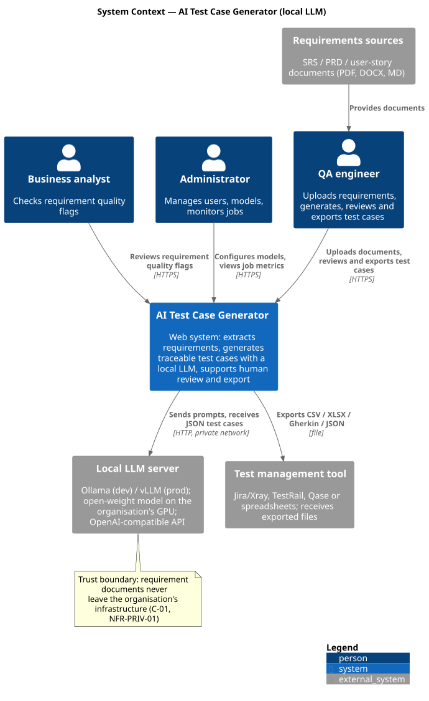
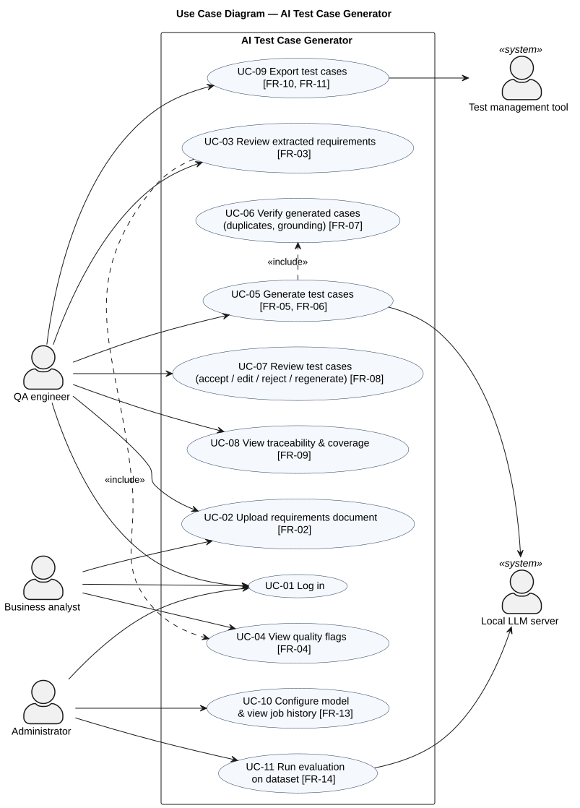
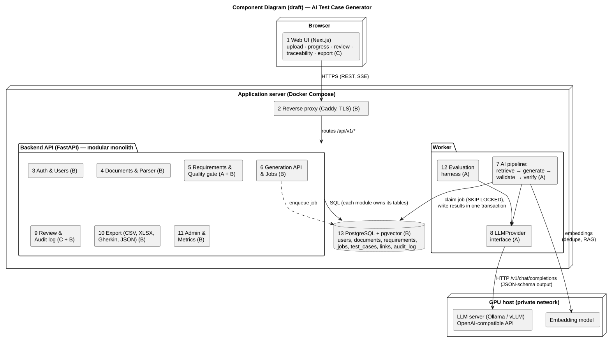

# 7. Architecture and Diagrams

The architecture is described by three diagrams: system context, use cases and components (draft). Editable PlantUML sources are stored in the repository (diagrams/src), exports in diagrams/export. Component numbers match the module matrix in Section 10.1.

## 7.1 High-Level Component Ownership

The system is organised into three principal layers with clear ownership:

**1. Web UI (Next.js): Kaisar Yessenov** — upload screens, real-time progress, review tables, coverage matrix.

**2. Backend API gateway and database (FastAPI + PostgreSQL): Sultan Muratbek** — authentication, document handling, job orchestration, export, metrics.

**3. AI pipeline worker and LLM runtime (vLLM / Ollama): Nuraly Abat** — requirement quality assessment, RAG, schema-constrained generation, evaluation harness.

## 7.2 System Context Diagram



*Figure 7.1 – System context diagram (C4 level 1)*

The system has three human actors and three external systems. The local LLM server is outside the application but inside the organisation's trust boundary, so requirement documents never leave the organisation (C-01, NFR-PRIV-01).

## 7.3 Use Case Diagram



*Figure 7.2 – Use case diagram*

*Table 7.1 – Use cases mapped to requirements*

| Use case | Actor(s) | Requirements |
|---|---|---|
| UC-01 Log in | All | FR-01, NFR-SEC-01 |
| UC-02 Upload requirements document | QA engineer, analyst | FR-02, NFR-SEC-03 |
| UC-03 Review extracted requirements | QA engineer | FR-03 |
| UC-04 View quality flags | Analyst (included in UC-03) | FR-04 |
| UC-05 Generate test cases | QA engineer, LLM server | FR-05, FR-06, FR-12, NFR-PERF-03, NFR-AIQ-01 |
| UC-06 Verify generated cases | Included in UC-05 | FR-07, NFR-AIQ-03 |
| UC-07 Review test cases | QA engineer | FR-08, NFR-SEC-05 |
| UC-08 View traceability and coverage | QA engineer | FR-09 |
| UC-09 Export test cases | QA engineer, test management tool | FR-10, FR-11 |
| UC-10 Configure model, view job history | Administrator | FR-13 |
| UC-11 Run evaluation | Administrator, LLM server | FR-14 |

## 7.4 Component Diagram (Draft)



*Figure 7.3 – Component diagram (draft). Owners: A – Nuraly Abat, B – Sultan Muratbek, C – Kaisar Yessenov*

*Table 7.2 – Components, responsibilities and data*

| # | Component | Responsibility | Key requirements | Data it owns |
|---|---|---|---|---|
| 1 | Web UI (Next.js) | Upload, generation, review, traceability and export screens | FR-02…FR-10, NFR-USAB, NFR-LANG-02 | — |
| 2 | Reverse proxy (Caddy) | TLS termination, single entry point | NFR-SEC-01, NFR-OPS-01 | — |
| 3 | Auth & Users | Registration, login, sessions, roles | FR-01, NFR-SEC-01/02 | users |
| 4 | Documents & Parser | Upload validation, text extraction (PDF/DOCX/MD) | FR-02, NFR-SEC-03 | documents |
| 5 | Requirements & Quality gate | Segmentation, stable IDs, ISO 29148 flags | FR-03, FR-04 | requirements, embeddings |
| 6 | Generation API & Jobs | Create / cancel jobs, stream progress (SSE) | FR-05, NFR-PERF-02, NFR-REL-01 | jobs |
| 7 | AI pipeline (worker) | Retrieve context → generate (JSON schema) → validate → verify → save in one transaction | FR-05…FR-07, FR-12, NFR-AIQ, NFR-SEC-04 | test_cases, links |
| 8 | LLMProvider interface | Runtime-agnostic calls to Ollama / vLLM | NFR-MAINT-02 | — |
| 9 | Review & Audit | Accept / edit / reject / regenerate; audit log | FR-08, NFR-SEC-05 | review status, audit_log |
| 10 | Export | CSV, XLSX, Gherkin, JSON (+ tool formats) | FR-10, FR-11 | — |
| 11 | Admin & Metrics | Model selection, job history, Prometheus metrics | FR-13, NFR-OPS-01 | configuration |
| 12 | Evaluation harness | Runs the dataset against gold cases, writes metric reports | FR-14 | evaluation results (files) |
| 13 | PostgreSQL + pgvector | Relational data, vectors, coverage views, audit triggers | NFR-REL-02 | all persistent data |

## 7.5 Main Scenario

**1. Upload.** The QA engineer uploads an SRS; Documents & Parser validates and stores it; the Requirements module extracts requirements with IDs and runs the quality gate.

**2. Start.** The QA engineer selects requirements and techniques; the Generation API creates a job (202 Accepted) and the UI subscribes to the SSE progress stream.

**3. Generate.** The worker claims the job, builds the prompt (requirement text as data, few-shot examples, retrieved context), receives JSON from the LLM, validates it against the schema (≤ 2 repair retries), checks requirement IDs and duplicates, and commits cases and links in one transaction.

**4. Review and export.** The QA engineer reviews the cases; decisions are logged; the coverage view updates; accepted cases are exported.

## 7.6 Data Model (Outline)

users 1–* projects 1–* documents 1–* requirements *–* test_cases (through test_case_requirements); documents 1–* generation_jobs 1–* test_cases; audit_log records review decisions. Views: v_coverage, v_traceability. The full ER diagram and a sequence diagram of generation are planned for pre-defense 2.

Editable sources: [`diagrams/src/`](../diagrams/src/) (PlantUML). Re-export after every change:

```bash
java -jar plantuml.jar -tsvg -o ../export diagrams/src/*.puml
java -jar plantuml.jar -tpng -o ../export diagrams/src/*.puml
```
