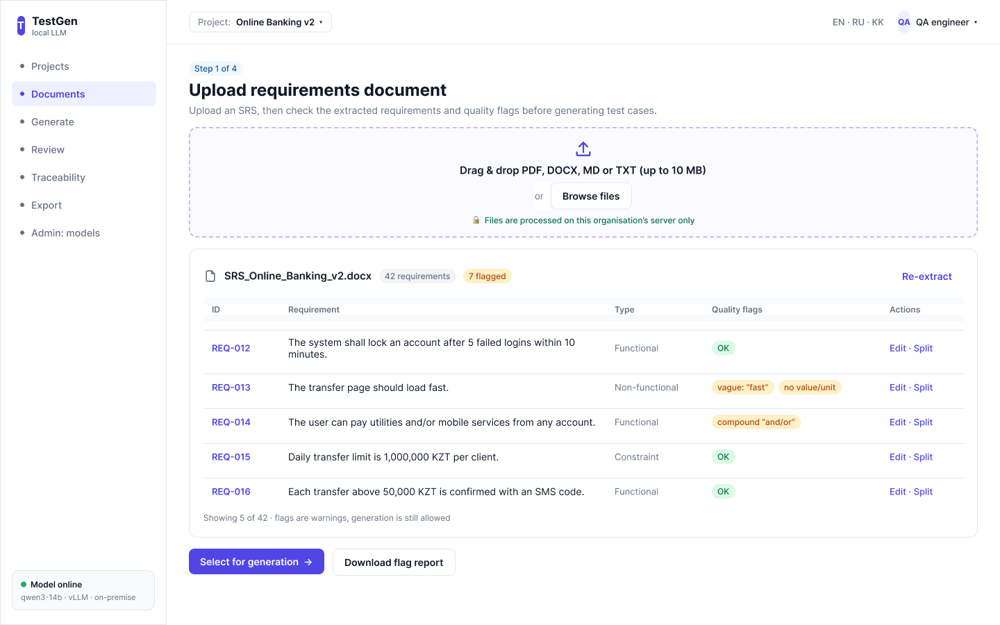
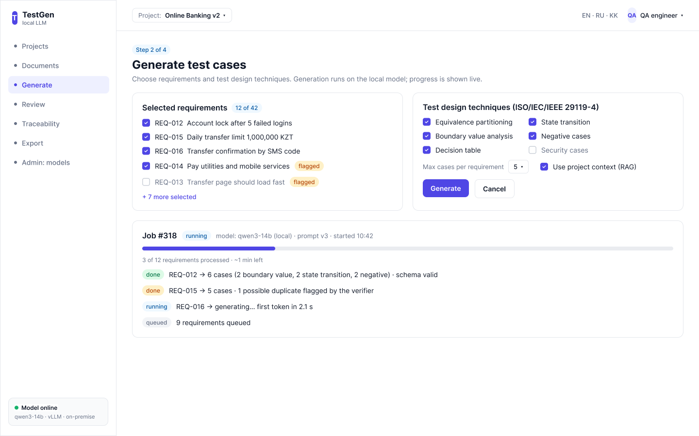
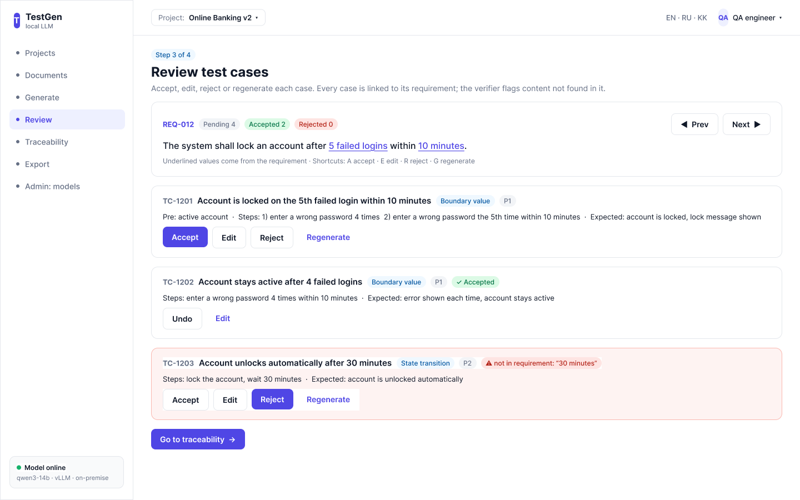
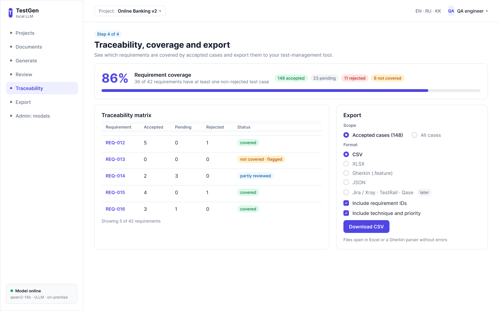

# 8. UX Prototype and Output Schema

The four key scenarios were first sketched as low-fidelity HTML wireframes (prototype/wireframes) and then built as a clickable prototype in Figma (owner: Kaisar Yessenov): https://www.figma.com/design/m2NAfVfFTXCA4SMN7yZp5F. In presentation mode the main buttons and the sidebar navigate between the screens W1 → W2 → W3 → W4. The screens are assembled from local components (Button, Badge, NavItem, Checkbox, Radio, Sidebar, Topbar), which will map to the Next.js components of the frontend.

## 8.1 Core Screens (Owner: Kaisar Yessenov)

*Table 8.1 – Key user scenarios*

| # | Scenario | Screen | Use cases | Requirements |
|---|---|---|---|---|
| 1 | Upload an SRS; check extracted requirements and ISO 29148 quality flags | W1 | UC-02, UC-03, UC-04 | FR-02…FR-04 |
| 2 | Select requirements and techniques; generate; watch progress (SSE); cancel if needed | W2 | UC-05, UC-06 | FR-05…FR-07, FR-12 |
| 3 | Review generated cases: inline edit, accept / reject / regenerate | W3 | UC-07 | FR-07, FR-08 |
| 4 | Check the coverage matrix and export accepted cases (CSV, XLSX, Gherkin, JSON) | W4 | UC-08, UC-09 | FR-09…FR-11 |



*Figure 8.1 – W1: upload and extracted requirements with quality flags*



*Figure 8.2 – W2: generation settings and live progress*



*Figure 8.3 – W3: review workspace (TC-1203 shows a verifier flag for content not found in the requirement)*



*Figure 8.4 – W4: traceability matrix, coverage and export*

## 8.2 UX Principles for an AI-Assisted Tool

**1. Show why a case exists:** the source requirement is visible next to every case.

**2. Show uncertainty:** quality flags on requirements, verifier flags on cases (possible duplicate, not grounded).

**3. Make rejecting as cheap as accepting** (one action); never overwrite a human edit automatically.

**4. Show model, prompt version and timing** for every job.

**5. Accessibility** (WCAG 2.2 AA basics) and UI languages EN / RU / KK.

## 8.3 Interaction with External Systems: API and Data Examples

API (draft): POST /api/v1/documents/{id}/generate → 202 Accepted {"job_id": "…"}; progress via GET /api/v1/jobs/{id}/events (Server-Sent Events); review via PATCH /api/v1/test-cases/{id}; export via GET /api/v1/documents/{id}/export?format=csv|xlsx|feature|json. The full OpenAPI specification is generated from the backend code.

Input to the AI pipeline (one requirement, passed as data):

```json
{
  "requirements": [
    {"id": "REQ-012", "text": "The system shall lock an account after 5 failed logins within 10 minutes."}
  ],
  "techniques": ["boundary_value", "state_transition", "negative"],
  "max_cases_per_requirement": 5
}
```

Expected output, validated against a JSON schema; every case cites an existing requirement ID:

```json
{
  "cases": [{
    "title": "Account is locked on the 5th failed login within 10 minutes",
    "requirement_ids": ["REQ-012"],
    "technique": "boundary_value",
    "priority": "P1",
    "preconditions": ["Active account exists"],
    "steps": [
      {"action": "Enter a wrong password 4 times within 10 minutes",
       "expected": "Error shown each time; account active"},
      {"action": "Enter a wrong password a 5th time within the same 10 minutes",
       "expected": "Account is locked and a lock message is shown"}
    ],
    "test_data": {"failed_attempts": "5", "window_minutes": "10"},
    "rationale": "Upper boundary of the allowed failed attempts"
  }]
}
```

Export example (Gherkin):

```gherkin
Feature: Account lock (REQ-012)
  Scenario: Account is locked on the 5th failed login within 10 minutes
    Given an active account
    When the user enters a wrong password 4 times within 10 minutes
    Then the account is still active
    When the user enters a wrong password a 5th time within the same 10 minutes
    Then the account is locked and a lock message is shown
```

## 8.4 Prototype Test with Users (Planned)

The clickable Figma prototype will be tested with 3 users (5-second test + one task each), for example: "Find which requirement has no test cases and export the accepted cases as CSV". Results and the resulting changes will be recorded in the table below.

*Table 8.2 – Prototype test results (template)*

| Participant | Task | Success | Time | Problems observed | Change made |
|---|---|---|---|---|---|
| U1 | Find the uncovered requirement and export accepted cases as CSV |  |  |  |  |
| U2 |  |  |  |  |  |
| U3 |  |  |  |  |  |

Figma prototype: https://www.figma.com/design/m2NAfVfFTXCA4SMN7yZp5F (Present ▶, flow "TestGen main flow"). Wireframe sources (editable HTML): [`prototype/wireframes/`](../prototype/wireframes/).
